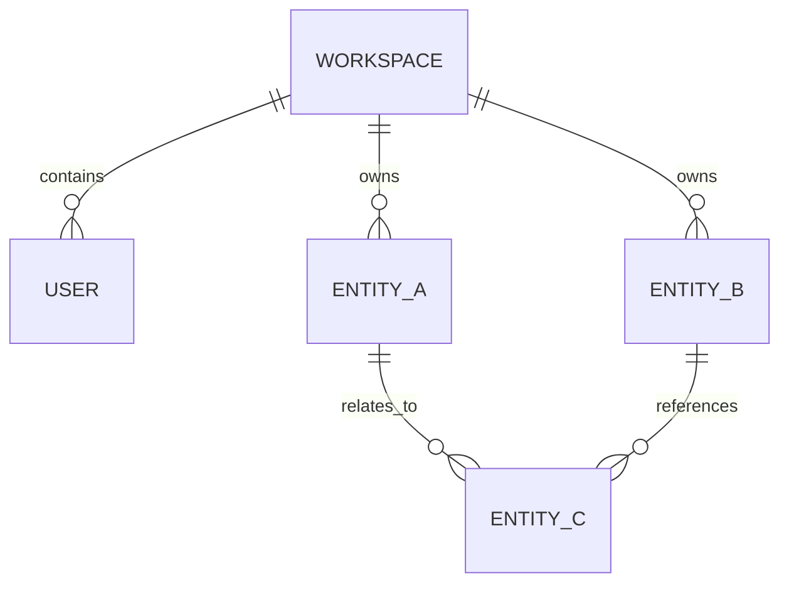

# PRD — [NAMA PRODUK]

> **Instruksi untuk AI / Penulis Dokumentasi:**  
> Ganti seluruh teks di dalam kurung siku `[ ... ]` dengan konteks produk yang sesungguhnya.  
> Pertahankan struktur numbering dan heading di bawah ini agar konsistensi dokumen tetap terjaga.  
> Jangan mengarang fitur atau aturan bisnis jika tidak diberikan; gunakan tag `[TBD]`, `[Asumsi]`, atau `[Pertanyaan Terbuka]`.

---

**Product Name:** [Nama Produk]  
**Product Type:** [Contoh: SaaS Platform / Mobile App / B2B Marketplace / Personal Productivity / FinTech Solution]  
**Platform:** [Contoh: Web App, Mobile (iOS/Android), PWA-ready, Desktop, API-first]  
**Project Scope:** [Frontend Only | Backend Only | Fullstack]  
**Target Market:** [Contoh: Indonesia / Asia Tenggara / Global]  
**Status:** [Product Definition / Pre-development / Active Development / MVP Phase]  
**Version:** [0.1.0]  
**Date:** [Tanggal Pembuatan, contoh: 16 Agustus 2026]  
**Author / Lead:** [Nama Penggagas / Tim Produk]  

---

# 1. Product Overview

## 1.1 Apa itu [Nama Produk]?

[Tulis 1-2 paragraf padat dan jelas yang menjelaskan produk ini secara esensial.]

**Contoh Definisi:**  
> **[Nama Produk] adalah [kategori platform] yang membantu [target pengguna utama] untuk [menyelesaikan masalah utama] melalui [mekanisme atau proposisi nilai unik] dalam satu sistem yang terpadu.**

### What It Is NOT (Batasan Eksplisit)
Untuk mencegah ruang lingkup meluas tanpa batas (*scope creep*), [Nama Produk] secara sadar **BUKAN** bertujuan untuk menjadi:
- Bukan pengganti [Sistem Enterprise Kompleks X / ERP / CRM Raksasa]
- Bukan klon dari [Aplikasi Populer Y] yang meniru seluruh fiturnya secara membabi buta
- Bukan [Aplikasi Z] yang memaksa pengguna mengisi puluhan formulir rumit

### Core Philosophy / Alur Inti
> **[Capture / Input] $\rightarrow$ [Process / Understand] $\rightarrow$ [Connect / Organize] $\rightarrow$ [Act / Execute] $\rightarrow$ [Automate / Scale]**

Pengguna tidak boleh dibebani kerumitan struktur data teknis di balik layar. Pengguna cukup melakukan aksi alami, dan sistem bertanggung jawab mengonversinya menjadi entitas data yang terstruktur dan bermakna.

---

# 2. Problem Statement

## 2.1 Kondisi Saat Ini (The Fragmented Reality)
Jelaskan bagaimana pengguna menyelesaikan masalah mereka hari ini tanpa produk ini.

```text
[Aplikasi/Metode 1: misal WhatsApp / Chat]
[Aplikasi/Metode 2: misal Spreadsheet / Excel]
[Aplikasi/Metode 3: misal Catatan Manual di Kertas]
[Aplikasi/Metode 4: misal Mobile Banking / Bukti Transfer di Galeri Foto]
[Aplikasi/Metode 5: misal Google Drive / Email]
```

## 2.2 Akar Masalah Utama (*The Core Problem*)
Masalah utamanya bukan sekadar ketiadaan aplikasi, melainkan:

> **[Sebutkan akar masalah dalam 1 kalimat tegas, contoh: "Informasi, konteks kerja, dan riwayat transaksi terfragmentasi di berbagai media sehingga tidak ada sistem yang memahami hubungan utuh di antara semuanya."]**

### Skenario Realita:
[Berikan 1 skenario nyata tentang bagaimana masalah tersebut menimbulkan kerugian waktu, uang, atau stres bagi pengguna.]

---

# 3. Product Vision & North Star

## 3.1 Visi Produk (*Vision Statement*)
> **"[Tuliskan visi produk jangka panjang yang ambisius namun realistis, contoh: To become the unified operating layer that empowers independent businesses to automate their daily execution effortlessly.]"**

## 3.2 Pertanyaan Filter (*Product North Star Question*)
Ketika tim di masa depan ragu apakah suatu fitur baru perlu dibuat atau tidak, gunakan pertanyaan ini:

> **"Apakah fitur ini secara langsung membantu [Target Pengguna] dalam [Tujuan Utama Produk] dengan lebih cepat, lebih mudah, dan minim friksi?"**
- Jika **YA** $\rightarrow$ Pertimbangkan masuk backlog / fase berikutnya.
- Jika **TIDAK** $\rightarrow$ **Tolak atau coret dari cakupan produk.**

---

# 4. Product Principles

Prinsip desain dan rekayasa produk yang harus dipegang teguh pada setiap keputusan teknis dan visual:

### 4.1 [Prinsip 1: misal Ringan & Cepat (*Lightweight & 0ms Latency*)]
Aplikasi tidak boleh terasa lambat. Aksi pencatatan dan navigasi utama harus dapat dieksekusi dengan friksi minimal.

### 4.2 [Prinsip 2: misal Input Sederhana (*Frictionless Capture*)]
Pengguna tidak dipaksa mengisi form panjang bertingkat jika data dapat disimpulkan secara otomatis melalui teks bebas, suara, dokumen, atau aksi sekali klik.

### 4.3 [Prinsip 3: misal Konteks Terhubung (*Context-First*)]
Setiap data yang dimasukkan ke dalam sistem tidak berdiri sendiri, melainkan otomatis tertaut ke entitas terkait (orang, proyek, transaksi, dokumen).

### 4.4 [Prinsip 4: misal Satu Input, Multi-Efek (*One Input, Multiple Effects*)]
Satu tindakan pencatatan pengguna harus secara otomatis memicu pembaruan pada seluruh modul terkait tanpa perlu penginputan ulang ganda (*redundant entry*).

### 4.5 [Prinsip 5: misal Privasi & Keandalan (*Offline-First / Secure by Default*)]
[Jelaskan prinsip keamanan atau keandalan data produk, misal: Data sensitif pengguna aman, dapat diakses saat offline, atau terenkripsi secara ketat.]

---

# 5. Target Users & Personas

| Kategori Persona | Target Pengguna | Karakteristik & Kebutuhan Utama | Pain Points Utama Saat Ini |
|:---|:---|:---|:---|
| **Primary Persona** | [Nama/Tipe Persona 1: misal Freelancer / Pekerja Mandiri] | [Deskripsi kebutuhan utama, jam terbang, dan ekspektasi] | [Frustrasi terbesar yang dialami] |
| **Secondary Persona** | [Nama/Tipe Persona 2: misal Pemilik Usaha Mikro / UMKM] | [Deskripsi operasional harian dan kebutuhan tim kecil] | [Kerumitan administrasi & pencatatan manual] |
| **Tertiary Persona** | [Nama/Tipe Persona 3: misal Klien / Pengguna Akhir / Admin] | [Kebutuhan melihat laporan / berinteraksi sesekali] | [Ketiadaan visibilitas progres / transparansi] |

---

# 6. Product Architecture & System Decomposition

Berikut adalah pemetaan modul fungsional yang membentuk ekosistem [Nama Produk]:

```text
                               ┌─────────────────────────────┐
                               │  [NAMA PRODUK] CORE SYSTEM   │
                               └──────────────┬──────────────┘
                                              │
         ┌──────────────────┬─────────────────┼─────────────────┬──────────────────┐
         │                  │                 │                 │                  │
         ▼                  ▼                 ▼                 ▼                  ▼
┌─────────────────┐┌─────────────────┐┌─────────────────┐┌─────────────────┐┌─────────────────┐
│   Modul 01:     ││   Modul 02:     ││   Modul 03:     ││   Modul 04:     ││   Modul 05:     │
│ [Nama Modul 1]  ││ [Nama Modul 2]  ││ [Nama Modul 3]  ││ [Nama Modul 4]  ││ [Nama Modul 5]  │
└─────────────────┘└─────────────────┘└─────────────────┘└─────────────────┘└─────────────────┘
```

---

# 7. Modul 01 — [Nama Modul Utama 1, misal: Otentikasi & Ruang Kerja]

## 7.1 Tujuan Modul
[Jelaskan apa yang dicapai oleh modul ini bagi pengguna.]

## 7.2 Fitur Utama
1. **[Fitur 1.1: misal Onboarding Cepat]**: [Deskripsi alur dan hasil yang diharapkan].
2. **[Fitur 1.2: misal Manajemen Profil & Workspace]**: [Deskripsi hak akses dan isolasi data].

## 7.3 Entitas Data Terkait
- `[Entitas 1]`: [Fungsi entitas dalam modul]
- `[Entitas 2]`: [Fungsi entitas dalam modul]

---

# 8. Modul 02 — [Nama Modul Utama 2, misal: Operasional & Manajemen Proyek]

## 8.1 Tujuan Modul
[Jelaskan nilai tambah operasional dari modul ini.]

## 8.2 Fitur Utama
1. **[Fitur 2.1]**: [Deskripsi fungsional].
2. **[Fitur 2.2]**: [Deskripsi fungsional].
3. **[Fitur 2.3]**: [Deskripsi fungsional].

## 8.3 Aturan Bisnis (*Business Rules*)
- **BR-01**: [Aturan validasi atau logika kalkulasi tertentu].
- **BR-02**: [Aturan perubahan status atau hak akses].

---

# 9. Modul 03 — [Nama Modul Utama 3, misal: Keuangan, Transaksi & Invoicing]

## 9.1 Tujuan Modul
[Jelaskan peran modul ini dalam pencatatan atau pemrosesan komersial.]

## 9.2 Fitur Utama
1. **[Fitur 3.1]**: [Deskripsi pencatatan kas/transaksi].
2. **[Fitur 3.2]**: [Deskripsi tagihan/invoice dan status pembayaran].

---

# 10. Modul 04 — [Nama Modul Tambahan 4, misal: Inventaris / Aset / Dokumen]

## 10.1 Tujuan Modul
[Jelaskan tujuan modul.]

## 10.2 Fitur Utama
1. **[Fitur 4.1]**: [Deskripsi fitur].
2. **[Fitur 4.2]**: [Deskripsi fitur].

---

# 11. Modul 05 — [Nama Modul Komunikasi / Notifikasi / Activity Feed]

## 11.1 Tujuan Modul
[Jelaskan konsolidasi peristiwa dan sistem pemberitahuan.]

## 11.2 Fitur Utama
1. **[Fitur 5.1: Linimasa Aktivitas Terpadu]**: [Mencatat setiap peristiwa perubahan sistem secara kronologis].
2. **[Fitur 5.2: Mesin Notifikasi Peringatan]**: [Deteksi jatuh tempo, stok menipis, atau tenggat waktu].

---

# 12. Cross-Cutting Capabilities (Kapabilitas Lintas Modul)

## 12.1 Quick Capture & Natural Language Processing
Mekanisme penangkapan data secara kilat melalui teks bebas atau suara yang secara otomatis diurai (*parse*) menjadi entitas yang sesuai.

## 12.2 Global Search & Command Center (`Ctrl+K` / `⌘K`)
Pusat navigasi instan untuk berpindah antar modul, mencari dokumen/entitas, atau menjalankan pintasan aksi cepat.

## 12.3 Automasi Berbasis Aturan (*Event-Condition-Action / ECA Engine*)
```text
WHEN [Peristiwa terjadi, misal: invoice_overdue]
IF   [Kondisi terpenuhi, misal: status != 'paid' && due_date < today]
THEN [Eksekusi aksi, misal: create_alert && send_reminder_prompt]
```

---

# 13. Domain Model & Context Graph (High-Level)

Diagram relasi entitas inti di dalam sistem:



---

# 14. Non-Functional Requirements (7 Software Quality Pillars)

Setiap arsitektur teknis dan implementasi produk wajib memenuhi 7 pilar atribut kualitas perangkat lunak:

### 14.1 Scalability (Skalabilitas)
- Kemampuan arsitektur database dan query menangani pertumbuhan volume data tanpa degradasi performa linear.
- Desain state management yang efisien untuk ribuan item transaksi dan entitas.

### 14.2 Maintainability (Kemudahan Perawatan)
- Arsitektur modular berbasis fitur (*feature-based folder structure*).
- Kontrak tipe data TypeScript yang ketat tanpa penggunaan tipe `any`.
- Prinsip *Single Responsibility* dan *High Cohesion / Low Coupling*.

### 14.3 Usability (Kemudahan Penggunaan & Aksesibilitas)
- Rasio kontras warna teks dan latar belakang memenuhi standar **WCAG AA ($\ge 4.5:1$)**.
- Struktur semantik HTML5 yang lengkap (penanda utama `<main>`, `<nav>`, `<header>`).
- Navigasi keyboard penuh (`Tab`, `Enter`, `Escape`) dan ramah pembaca layar (*screen reader*).
- Desain responsif *mobile-first* dengan target sentuh minimum $44 \times 44\text{px}$.

### 14.4 Reliability & Availability (Keandalan & Ketersediaan)
- Target ketersediaan layanan $\ge 99.9\%$.
- Ketahanan offline (*Local-First / PWA Offline*): Aplikasi tetap dapat dibuka, dibaca, dan mencatat data saat koneksi internet terputus.
- Penanganan error (*graceful degradation*) dengan pesan kesalahan yang informatif.

### 14.5 Security & Data Privacy (Keamanan & Privasi)
- Isolasi multi-tenant yang ketat berdasarkan `workspaceId`.
- Proteksi kerentanan web standar OWASP Top 10 (XSS, CSRF, Injection).
- Enkripsi data sensitif pengguna (*at rest* pada media penyimpanan dan *in transit* via TLS/HTTPS).

### 14.6 Performance & Efficiency (Performa & Efisiensi)
- **Core Web Vitals Target**:
  - First Contentful Paint (FCP) $\le 1.0\text{s}$ (Skor Lighthouse $\ge 95$).
  - Largest Contentful Paint (LCP) $\le 1.5\text{s}$.
  - Total Blocking Time (TBT) $\le 50\text{ms}$ (Target: $0\text{ms}$).
  - Cumulative Layout Shift (CLS) $\le 0.01$.
- Responsivitas aksi antarmuka $\le 100\text{ms}$ (Zero UI Lag).
- Optimalisasi bundle: Code-splitting dinamis via `React.lazy()` dengan ukuran entri inti $\le 100\text{kB}$ (Gzip $\le 30\text{kB}$).

### 14.7 Flexibility & Extensibility (Fleksibilitas & Ekstensibilitas)
- Desain arsitektur extensible: Penambahan modul baru di masa depan dapat dilakukan secara *plug-and-play* tanpa merombak skema tabel atau state inti.

---

# 15. UI Kit & Living Storybook Specification (Khusus Frontend & Fullstack)

> 💡 **Ketentuan Proyek**: Bagian ini **WAJIB** untuk proyek bertipe *Frontend Only* atau *Fullstack App*. Jika proyek bertipe *Backend Only (API/CLI)*, bagian ini dapat dilewati.

Untuk menjamin konsistensi visual, kecepatan pengembangan, dan dokumentasi komponen antarmuka yang transparan, aplikasi menyediakan halaman internal:

- **Rute Dokumentasi**: `/kit/core-ui` (atau `/kit`)
- **Fitur UI Kit**:
  1. **Living Component Storybook**: Menampilkan seluruh varian tombol (`Button`), badge status (`Badge`), kartu (`Card`), form input (`Input`), pemilih tab (`SegmentedControl`), avatar (`CartoonAvatar`), dan modal dialog (`Modal`, `ConfirmDialog`).
  2. **Interactive Props Playground**: Kontrol langsung untuk menguji kombinasi *props* (ukuran `sm/md/lg`, status `loading`, `disabled`, varian warna) secara *real-time*.
  3. **Copyable Code Snippets**: Tombol 1-klik untuk menyalin kode JSX siap pakai.
  4. **API Props Table**: Tabel referensi nama prop, tipe data, nilai default, dan deskripsi.
  5. **Theme & Token Inspector**: Pengujian live untuk palet warna, tipografi, dan kurva *iOS Squircle*.
- **Dev-Only Guard (0 Bytes Production Overhead)**:
  ```tsx
  const isDev = import.meta.env.DEV;
  const CoreUiKitPage = isDev
    ? lazy(() => import('../features/kit/CoreUiKitPage').then(m => ({ default: m.CoreUiKitPage })))
    : null;
  ```
  Saat aplikasi di-build untuk rilis publik (*production*), rute dan seluruh kode UI Kit otomatis dipangkas (*tree-shaken*) dari bundle.

---

# 16. Roadmap Pelaksanaan & Rencana Rilis

```text
Fase 0: Fondasi Desain, Design Tokens, Setup Repository & Domain Contract
Fase 1: Core Capture, Onboarding System & UI Kit Showcase (/kit/core-ui)
Fase 2: Modul Utama (Operasional & Transaksi Inti)
Fase 3: Modul Pendukung (Manajemen Aset / Dokumen / Inventaris)
Fase 4: Cross-Cutting Engine (Quick Action, Command Palette, Activity Feed)
Fase 5: Intelligence & Automasi Lanjut (OCR / Smart Insights)
Fase 6: Integrasi Eksternal & Polishing
```

---

# 17. Definisi MVP (Minimum Viable Product Vertical Slice)

> ⚠️ **PERINGATAN DISIPLIN PRODUK:**  
> Meskipun dokumen ini mendefinisikan seluruh visi aplikasi, **MVP TIDAK BOLEH membangun semua modul sekaligus**.

MVP harus membuktikan satu hipotesis nilai inti:

> **"[Tuliskan hipotesis nilai MVP, contoh: Dapatkah pengguna mencatat kebutuhan operasionalnya secara alami dan melihat hasil perhitungan saldo serta proyeknya terhubung tanpa friksi?]"**

### Slicing Alur Vertikal MVP:
```text
Pengguna Masuk / Registrasi
       ↓
Input Data Inti (Quick Capture / Form)
       ↓
Pembuatan Entitas Utama (Proyek / Transaksi / Kontak)
       ↓
Sinkronisasi Otomatis Antar Entitas
       ↓
Output / Hasil Bernilai (Dashboard / Laporan Ringkas)
```

---

# 18. Definition of Done (DoD) — Product Level

Sebuah fitur atau modul baru dianggap **SELESAI (DONE)** jika dan hanya jika:
- [ ] User flow dan logika transisi status telah didefinisikan secara tuntas.
- [ ] Kontrak tipe data (TypeScript / Schema) telah teruji tanpa error.
- [ ] Memenuhi 7 Pilar Kualitas Perangkat Lunak (NFR).
- [ ] Status antarmuka lengkap: **Loading State**, **Empty State**, **Error State**, dan **Success State**.
- [ ] Responsif 100% pada tampilan Mobile, Tablet, dan Desktop.
- [ ] Standar aksesibilitas dan kontras warna WCAG AA terpenuhi.
- [ ] Komponen baru terdokumentasi di UI Kit (`/kit/core-ui`) jika proyek berbasis frontend.
- [ ] Skenario pengujian fungsional dan *edge cases* telah diverifikasi.

---

# 19. Prinsip & Batasan untuk AI / Coding Agent

Ketika dokumen ini diserahkan kepada AI Coding Agent (Claude, Antigravity, GitHub Copilot, dsb.):

1. **Modular Scope Guard**: Hanya implementasikan fase atau modul yang secara spesifik diminta oleh pengguna pada percakapan aktif. **Jangan membangun modul fase masa depan secara prematur**.
2. **Preserve Domain Boundaries**: Jaga batas-batas arsitektur dan relasi entitas agar modul masa depan dapat terintegrasi tanpa perlu menulis ulang (*refactor*) modul inti.
3. **No Unspecified Features**: **Dilarang keras mengarang fitur atau integrasi** yang tidak tercantum dalam spesifikasi kebutuhan aktif.
4. **Technology Stack Note**: Keputusan tumpukan teknologi teknis harus disesuaikan dengan arsitektur yang disetujui, di mana kebutuhan produk menentukan teknologi, bukan sebaliknya.

---

# 20. Rencana Dekomposisi Dokumentasi (Decomposition Plan)

Setelah Master PRD ini disetujui, AI Agent **wajib merencanakan pemecahan dokumen** ke dalam 14 file modular terstruktur berikut di dalam folder `docs/`:

1. `01-product-overview.md` $\rightarrow$ Visi, Misi, Masalah, Nilai Tambah & Batasan.
2. `02-domain-model.md` $\rightarrow$ Entitas, Graph Relasi, TypeScript Interfaces, Status Enums.
3. `03-users-personas-and-use-cases.md` $\rightarrow$ Profil Persona, User Journey, Jobs-To-Be-Done.
4. `04-product-requirements.md` $\rightarrow$ Kebutuhan Fungsional per Modul (FR-01 s/d FR-XX).
5. `05-feature-specifications.md` $\rightarrow$ Detail Spesifikasi Tiap Fitur & Input/Output.
6. `06-user-flows.md` $\rightarrow$ Ringkasan Alur Pengguna Makro.
7. `07-system-architecture.md` $\rightarrow$ Komponen Arsitektur, State Management, Storage.
8. `08-data-and-api-contracts.md` $\rightarrow$ Endpoint Kontrak API / Skema Database.
9. `09-security-and-permissions.md` $\rightarrow$ Autentikasi, RBAC, Privasi & Keamanan Data.
10. `10-ui-ux-specification.md` $\rightarrow$ Desain Token, Tipografi, Warna, Komponen & UI Kit Showcase.
11. `11-non-functional-requirements.md` $\rightarrow$ 7 Pilar NFR (Scalability, Maintainability, Usability, Reliability, Security, Performance, Extensibility).
12. `12-testing-strategy.md` $\rightarrow$ Skenario Pengujian (Unit, Integrasi, E2E).
13. `13-implementation-guidelines.md` $\rightarrow$ Standar Struktur Kode, Dev-Only Guards, & Panduan Coding Agent.
14. `14-roadmap-and-mvp.md` $\rightarrow$ Fase Eksekusi, Cakupan MVP, Definition of Done.
