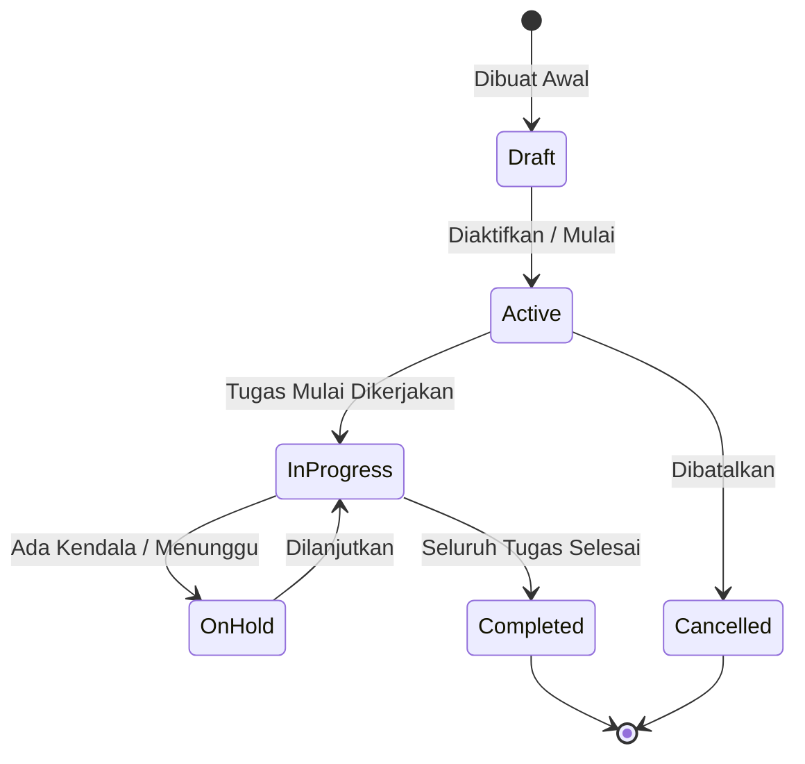

# 02 — Domain Model & Context Graph

> **Instruksi untuk AI / Penulis Dokumentasi:**  
> Gunakan template ini untuk mendefinisikan arsitektur data, entitas inti, relasi antar-entitas (*Context Graph*), dan kontrak tipe TypeScript untuk produk `[Nama Produk]`.

---

## 1. Domain Model Overview & Context Graph

Sistem `[Nama Produk]` berlandaskan pada arsitektur **Entity-Relationship Context Graph**. Setiap entitas di dalam sistem terisolasi dalam satu ruang kerja (`[Workspace / Tenant / Account Scope]`) dan dapat saling berelasi secara kontekstual.

### Diagram Relasi Entitas Makro:
```text
                         ┌─────────────────────────────┐
                         │  [Root Scope / Workspace]   │
                         └──────────────┬──────────────┘
                                        │
         ┌──────────────────┬───────────┴───────────┬──────────────────┐
         │                  │                       │                  │
         ▼                  ▼                       ▼                  ▼
  [Entitas Utama A]  [Entitas Utama B]       [Entitas Utama C]  [Entitas Penunjang]
   ├── Sub-Tipe 1     ├── Sub-Tipe 1          ├── Sub-Tipe 1     ├── Dokumen/Bukti
   ├── Sub-Tipe 2     ├── Sub-Tipe 2          ├── Sub-Tipe 2     └── Catatan/Log
   └── Sub-Tipe 3     └── Sub-Tipe 3          └── Sub-Tipe 3
```

---

## 2. Core Entities & Hierarchy Breakdown

### 2.1 Scope & Root Context
- **`[Workspace / Organization / User]`**: Batas isolasi data tertinggi. Semua data transaksi, aset, dan riwayat operasional terikat pada satu `[workspaceId / tenantId]`.

### 2.2 Entitas Stakeholder & Identitas (`[Person / Member / User Layer]`)
Entitas yang merepresentasikan manusia atau organisasi yang berinteraksi dalam sistem. Satu entitas dapat memiliki berbagai peran polimorfik:
- **`[Role A: misal Customer / Client]`**: Pihak penerima layanan/pembeli.
- **`[Role B: misal Supplier / Vendor]`**: Pihak penyedia barang/jasa.
- **`[Role C: misal Team Member / Operator]`**: Pihak pelaksana tugas internal.

### 2.3 Entitas Eksekusi & Operasional (`[Work / Project / Transaction Layer]`)
Wadah eksekusi aktivitas utama aplikasi:
- **`[Entitas Induk Operasional: misal Project / Case / Order]`**: Mengelompokkan aktivitas, jadwal, biaya, dan hasil kerja.
- **`[Entitas Item Eksekusi: misal Task / Step / Item]`**: Unit tugas terkecil yang memiliki status, penanggung jawab, dan tenggat waktu.

### 2.4 Entitas Komersial & Finansial (`[Finance / Invoicing Layer]`)
- **`[Transaction]`**: Catatan arus kas riil (*Income*, *Expense*, *Transfer*).
- **`[Invoice / Bill]`**: Tagihan resmi dengan status termin pembayaran.

### 2.5 Entitas Fisik, Dokumen, atau Aset (`[Resource / Document Layer]`)
- **`[Resource / Document]`**: Berkas atau aset fisik yang selalu memiliki relasi polimorfik (`relatedEntityId` dan `relatedEntityType`).

### 2.6 Entitas Audit & Linimasa (`[Activity / Event Log Layer]`)
- **`[ActivityLog]`**: Setiap peristiwa penting dicatat sebagai *immutable event log* untuk menyusun *Unified Activity Timeline*.

---

## 3. TypeScript Domain Definitions & Type Contracts

```typescript
/**
 * Tipe Dasar & ID Scope
 */
export type ID = string;
export type ISODateString = string;

export interface BaseEntity {
  id: ID;
  workspaceId: ID;
  createdAt: ISODateString;
  updatedAt: ISODateString;
  isDeleted?: boolean;
}

/**
 * 1. Definisi Entitas Identitas / Stakeholder
 */
export type StakeholderRole = 'customer' | 'supplier' | 'vendor' | 'partner' | 'internal';

export interface Stakeholder extends BaseEntity {
  name: string;
  phone?: string;
  email?: string;
  roles: StakeholderRole[];
  notes?: string;
  metadata?: Record<string, unknown>;
}

/**
 * 2. Definisi Entitas Operasional / Proyek
 */
export type OperationStatus = 'draft' | 'active' | 'in_progress' | 'on_hold' | 'completed' | 'cancelled';
export type PriorityLevel = 'low' | 'normal' | 'high' | 'urgent';

export interface OperationUnit extends BaseEntity {
  title: string;
  description?: string;
  stakeholderId?: ID;
  status: OperationStatus;
  priority: PriorityLevel;
  startDate?: ISODateString;
  dueDate?: ISODateString;
  progressPercentage: number; // 0 - 100
}

/**
 * 3. Definisi Entitas Finansial / Transaksi
 */
export type TransactionType = 'income' | 'expense' | 'transfer';

export interface FinancialRecord extends BaseEntity {
  type: TransactionType;
  amount: number;
  category: string;
  description: string;
  transactionDate: ISODateString;
  relatedOperationId?: ID;
  relatedStakeholderId?: ID;
}

/**
 * 4. Definisi Entitas Event / Activity Log
 */
export type ActivityActionType = 'created' | 'updated' | 'status_changed' | 'payment_recorded' | 'deleted';

export interface ActivityEvent extends BaseEntity {
  entityType: string;
  entityId: ID;
  action: ActivityActionType;
  title: string;
  details?: string;
  timestamp: ISODateString;
}
```

---

## 4. Entity State Machines & Status Transitions

### Mesin Status: `[Nama Entitas, misal: OperationUnit]`


### Aturan Validasi Transisi Status:
1. **Aturan 1**: Status tidak dapat diubah menjadi `completed` jika masih ada tugas wajib (*blocking tasks*) yang belum terselesaikan.
2. **Aturan 2**: Perubahan ke `cancelled` mewajibkan pengisian catatan alasan pembatalan.

---

## 5. Domain Invariants & Data Integrity Rules

1. **Aturan Isolasi Multi-Tenant**: Seluruh query database atau pencarian lokal **wajib menyertakan filter `workspaceId`**.
2. **Kekekalan Log (*Immutability of Activity Logs*)**: Entitas `ActivityEvent` bersifat *append-only*; data log tidak boleh diedit atau dihapus secara langsung.
3. **Keterkaitan Finansial (*Financial Referential Integrity*)**: Penghapusan entitas operasional tidak boleh menghapus transaksi riil yang telah terjadi di buku kas (tetapkan `relatedOperationId = null` saat dihapus).
