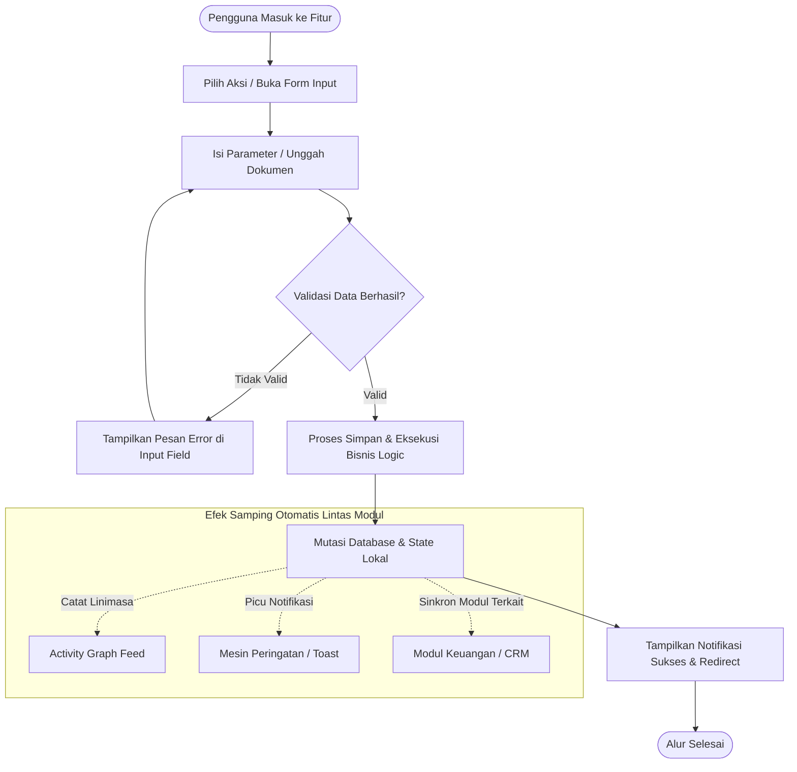

# [Nomor Urut, misal: 01]. Alur [Nama Fitur / Modul]

> **Instruksi untuk AI / Penulis Dokumentasi:**  
> Gunakan template ini untuk membuat file dokumentasi alur fitur di dalam folder `docs/flow-app/`.  
> Contoh nama file: `01_ALUR_ONBOARDING_DAN_AUTENTIKASI.md`, `02_ALUR_MANAJEMEN_PROYEK.md`, `03_ALUR_TRANSAKSI_KAS.md`.

---

## 📌 Ringkasan Alur & Ruang Lingkup
Dokumen ini menjelaskan alur operasional, interaksi pengguna (*User Experience*), reaksi sistem (*System Response*), mutasi data, dan efek samping lintas modul untuk fitur **[Nama Fitur]** pada rute `[misal: /feature-path]`.

---

## 🎯 1. Metadata Alur Fitur
- **Nama Fitur**: [Nama Fitur Lengkap]
- **Aktor Utama**: [Primary User / Administrator / Guest / dsb.]
- **Entry Points (Pintu Masuk)**:
  - Rute Langsung: `[misal: /projects/new]`
  - Tombol Navigasi: `[misal: Klik tombol 'Buat Proyek' di Header/Sidebar]`
  - Quick Action / Shortcut: `[misal: Tekan Ctrl+K -> Pilih 'Proyek Baru']`
- **Prakondisi (*Preconditions*)**:
  - [Sesi pengguna harus aktif dan memiliki workspace terdaftar]
  - [Data pendukung X sudah ada, atau opsi buat baru instan tersedia]

---

## 📋 2. Diagram Alur Sistem (*System Flowchart / Sequence*)

---

## 🚀 3. Rincian Langkah Demi Langkah (*Step-by-Step Execution*)

### Tahap 1: Inisiasi & Tampilan Awal (*Entry & Initial State*)
- **Aksi Pengguna**: Pengguna mengklik tombol `[Nama Tombol]` atau mengakses halaman `[URL]`.
- **Respon Sistem**:
  - Membuka modal/halaman dengan animasi transisi halus ($\le 150$ ms).
  - Jika data belum ada, sistem menampilkan **Empty State** yang informatif dengan tombol *Call-to-Action* (CTA).

### Tahap 2: Pengisian & Interaksi (*User Interaction & Real-Time Feedback*)
- **Aksi Pengguna**: Mengisi form atau mengetikkan bahasa alami.
- **Respon Sistem**:
  - Memberikan feedback validasi langsung (*inline real-time validation*).
  - Menghitung kalkulasi otomatis jika ada (contoh: margin profit = *Revenue* - *Spent*).

### Tahap 3: Konfirmasi & Eksekusi (*Submission & Processing*)
- **Aksi Pengguna**: Mengklik tombol **`[Simpan / Eksekusi / Konfirmasi]`** atau menekan tombol `Enter`.
- **Respon Sistem**:
  - Mengubah tombol ke status **Loading State** (spinner aktif, tombol ter-disable sementara untuk mencegah *double-click*).
  - Menyimpan data ke penyimpanan lokal / database.

---

## 🔀 4. Alur Alternatif & Penanganan Masalah (*Edge Cases & Error Flows*)

| Skenario / Kondisi | Respon Sistem & UX Feedback | Aksi Pemulihan (*Recovery Action*) |
|:---|:---|:---|
| **Form Kosong / Tidak Lengkap** | Muncul highlight merah pada field wajib beserta pesan error yang jelas. | Fokus kursor otomatis diarahkan ke input field pertama yang bermasalah. |
| **Koneksi Terputus / Offline** | Data tetap tersimpan aman di penyimpanan lokal (*Local-First*), muncul badge *Saved Locally*. | Sinkronisasi otomatis berjalan di latar belakang saat koneksi pulih. |
| **Batal / Menutup Form** | Jika pengguna sudah mengetik, muncul dialog konfirmasi pembatalan agar data tidak hilang secara tidak sengaja. | Pengguna dapat memilih *Lanjutkan Mengisi* atau *Buang Perubahan*. |

---

## 🎭 5. Matriks Status Antarmuka (*UI State Matrix*)

| State | Kondisi Pemicu | Tampilan & Perilaku Komponen |
|:---|:---|:---|
| **Default State** | Halaman dimuat dengan data yang sudah tersedia | Kartu data tersusun rapi dengan indikator status, filter aktif, dan aksi cepat. |
| **Loading State** | Data sedang diproses atau di-fetch | Skeleton loading shimmer halus, interaksi tombol dinonaktifkan sementara. |
| **Empty State** | Belum ada data sama sekali di sistem | Ilustrasi ramah, teks penjelas nilai fitur, dan tombol primer *Mulai Buat [Item]*. |
| **Error State** | Terjadi kegagalan validasi atau sistem | Banner alert merah ramah pengguna, rincian masalah, dan tombol *Coba Lagi*. |
| **Success State** | Aksi berhasil dieksekusi 100% | Toast notification hijau / modal sukses, linimasa terupdate seketika. |

---

## 🔄 6. Mutasi Data & Efek Samping Lintas Modul (*Data Mutation & Side Effects*)

### A. Operasi Data (CRUD Matrix):
- **Create (Buat)**: Membuat rekaman baru pada entitas `[Nama Entitas Utama]`.
- **Read (Baca)**: Membaca relasi kontak `[Nama Entitas Relasi]` dan saldo terkait.
- **Update (Ubah)**: Memperbarui nilai progres dan status entitas induk.
- **Delete (Hapus)**: *Soft delete* dengan penandaan `isDeleted = true`.

### B. Multi-Effect Synchronization:
1. **Activity Graph Feed**: Otomatis mencatat peristiwa baru `[misal: 'Proyek Baru Dibuat']` dengan cap waktu (*timestamp*).
2. **Modul Keuangan**: Otomatis memperbarui estimasi pemasukan di buku kas.
3. **Peringatan / Notifikasi**: Menghidupkan alarm pengingat jika tenggat waktu $\le 3$ hari.

---

## 🧪 7. Kriteria Penerimaan (*Acceptance Criteria*) & Skenario Pengujian

### Skenario Uji 1: Alur Sukses Utama (*Happy Path*)
- **GIVEN**: Pengguna berada di halaman `[Rute]` dengan sesi aktif.
- **WHEN**: Pengguna mengisi seluruh field wajib dengan valid dan mengklik `[Simpan]`.
- **THEN**: Data baru langsung muncul di daftar, notifikasi sukses hijau tampil, dan entitas terkait terupdate otomatis.

### Skenario Uji 2: Validasi Error (*Validation Path*)
- **GIVEN**: Pengguna membuka modal input `[Nama Fitur]`.
- **WHEN**: Pengguna mengosongkan field wajib `[Nama Field]` dan menekan `[Simpan]`.
- **THEN**: Sistem menolak submit, menampilkan pesan error `"Field X wajib diisi"`, dan tidak ada data dummy yang tersimpan.

---

## 🖥️ 8. Layar & Komponen UI yang Terlibat
- **Halaman Utama**: `[src/features/.../FeaturePage.tsx]`
- **Komponen Modal / Drawer**: `[src/features/.../FeatureModal.tsx]`
- **Komponen UI Bersama**: `Button`, `Input`, `Card`, `Badge`, `ConfirmDialog`, `SegmentedControl`.
